<div dir="rtl">

<p align="center">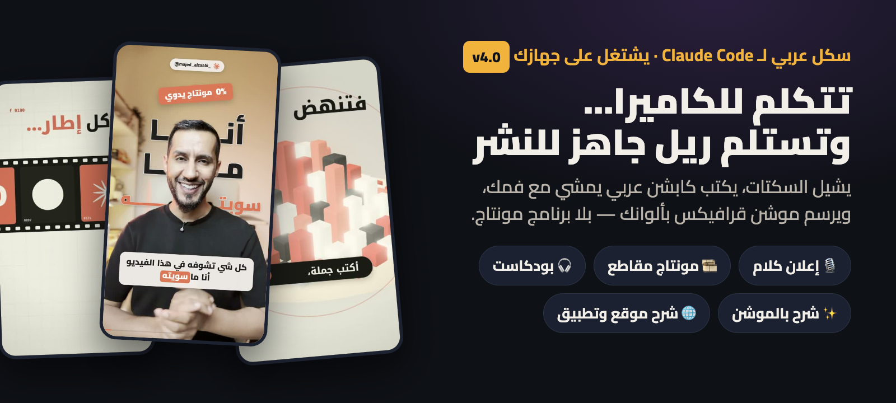</p>

<p align="center"><b>تتكلم للكاميرا… وتستلم ريل عمودي جاهز للنشر.</b><br>
يشيل السكتات، يكتب كابشن عربي يمشي مع فمك، ويرسم موشن قرافيكس بألوانك — بلا برنامج مونتاج — من الجوال أو الكمبيوتر.</p>

<p align="center"><a href="#start">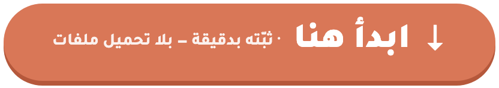</a><br>
<sub>مجاني · يشتغل من <b>الجوال</b> والكمبيوتر · ما تحتاج تيرمنال ولا تحمّل ملفات</sub></p>

<br>

---

## 🆕 الجديد — 6.5

### ✂️ قصّ الشعر الناعم — تحط نفسك فوق أي خلفية بلا هالة

<p align="center">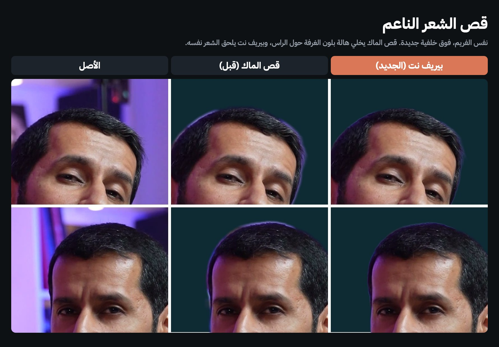</p>

<table width="100%"><tr>
<td width="42%" align="center" valign="top">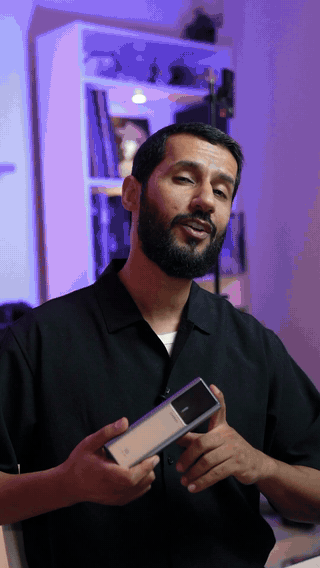</td>
<td width="58%" valign="top">

- القص الجديد **بيريف نت** يلحق الشعر نفسه، وينظّف لون الغرفة من الأطراف — **مجاني ويشتغل على جهازك**
- يشتغل لحاله لما يكون فيه كلام ورا راسك، وباقي اللقطات قص الماك بحواف منظفة (ثواني)
- ومعه: الكلمة تطلع مع بداية نطقها بالضبط · كلمة مضيئة تنوّر الجدار ورا راسك · 46 مؤثر صوتي حقيقي · حركة «قائمة تنكشف»
- **6.5.1:** حركة 102 **«تفكيك الطبقات»** — طبقات 3D تنفك وحدة وحدة، وخط منقّط لاسم كل طبقة لحظة ما تنطقه · والكلام ورا راسك **ما ياكل حرف ولا نقطة**: الكلمة تنمد بكشيدة تجي على راسك بالضبط
- **6.5.2:** **لون تصويرك ما يتغيّر** — الريل يطلع بنفس ألوان الآيفون (كان الأحمر ينقص 2٪)، وما يفتّح على كويك تايم وتطبيق الصور بعد ما ينحط الكفر
- **6.6.0:** **أفكار حركة من برّا وقت الحاجة** — لما جملتك تبي شكل مو موجود ببنك الحركات، السكل يطل على شغل ناس سووا شي مشابه وياخذ **الفكرة بس** ويرسمها بهويتك · ولا شي ينحفظ داخل البلقن وحجمه ما كبر

</td>
</tr></table>

<details><summary><b>وقبلها بـ6.3</b> — «اشرح لي شلون يشتغل …»</summary>


<table width="100%"><tr>
<td width="42%" align="center" valign="top">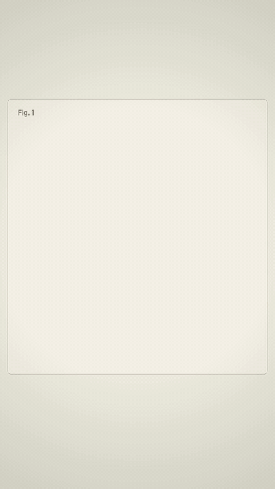</td>
<td width="58%" valign="top">

### ⚙️ «اشرح لي شلون يشتغل …» — أي جهاز يصير آلة ترتسم وتشتغل

اكتب لكلود جملة وحدة:

**«اشرح لي شلون يشتغل المكيف»**

- يدوّر المعلومة من **مصدر موثوق** أول، وكل جملة على الشاشة لها مصدر
- يرسم الجهاز **مقصوص** على لوح، خط خط بالحبر
- بعدها **يشغّله** قدامك: المروحة تدور، السلك يحمر، الموجات ترتد…
- وتحته **2–3 خطوات** بالعامية

تنفع للمعلمين وشرح الدروس وأي «شلون يصير …؟» — المكيف، الثلاجة، السيارة، القلب…

</td></tr></table>

</details>

<details><summary><b>وقبلها بـ6.2</b> — إطار ثابت · جدار شرائح 3D · شعار 3D بريل الكلام · كابشن «قطع»</summary>

<p align="center">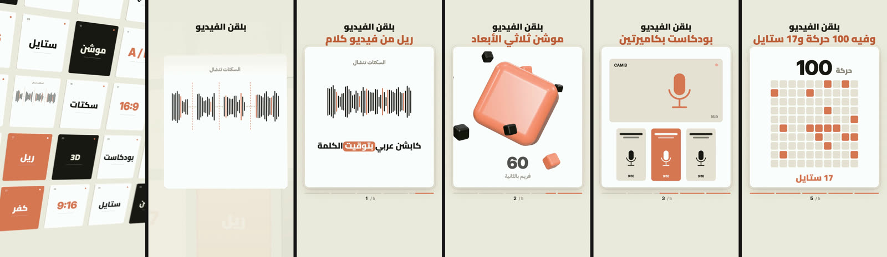</p>

| الجديد | اكتب |
|---|---|
| فيلم موشن بعنوان ثابت فوق والمحتوى يتبدل تحته (يبين لقطة وحدة) | «سوّه بإطار ثابت» |
| الكاميرا تطير فوق كروت 3D وكرت ينزل يصير أول مشهد | «أبي جدار شرائح» |
| شعار بسماكة ولمعة وظل بريل الكلام | «حط الشعار ثري دي» |
| كابشن قطع لين 4 كلمات والكلمة المنطوقة ملوّنة | «الكابشن قطع» |

هذي **بطلبك بس** — مو بكل فيديو.
</details>

<br>

---

<a id="start"></a>

## 🚀 ابدأ هنا — 3 خطوات

<p align="center">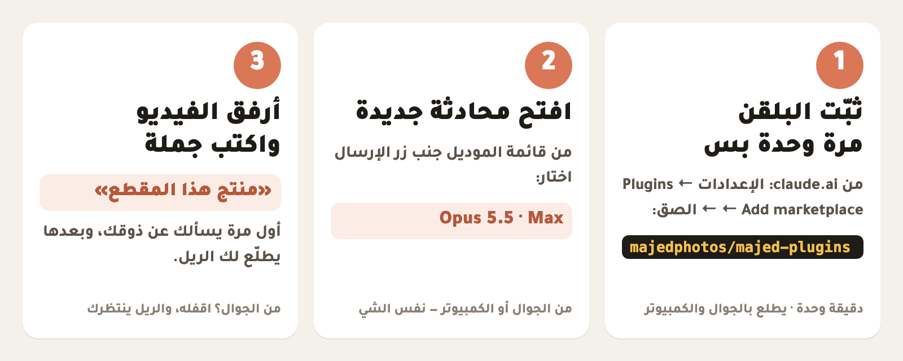</p>

<p align="center"><b>انسخ اسم المتجر من هني</b> (زر النسخ على يمين المربع) والصقه بـ<b>Add marketplace</b>:</p>

<div dir="ltr">

```
majedphotos/majed-plugins
```

</div>

### 1️⃣ ثبّت البلقن — مرة وحدة بس (دقيقة)

**نفس الطريقة للكل** — جوال، كمبيوتر، تطبيق الديسكتوب. ما تحتاج تيرمنال ولا تحمّل ملف. تثبّته مرة من **claude.ai** ويطلع لك بالويب والديسكتوب والجوال، ويتحدّث بروحه.

**1.** افتح **claude.ai** ← اضغط اسمك تحت ← **Settings**

<p align="center">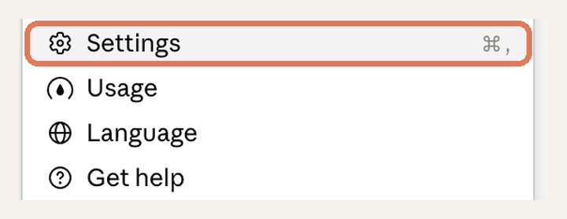</p>

**2.** تحت **Customize** ← **Plugins** ← **Add** ← **Add marketplace**

<p align="center">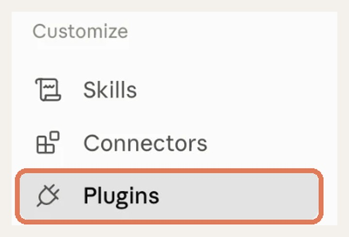</p>

<p align="center">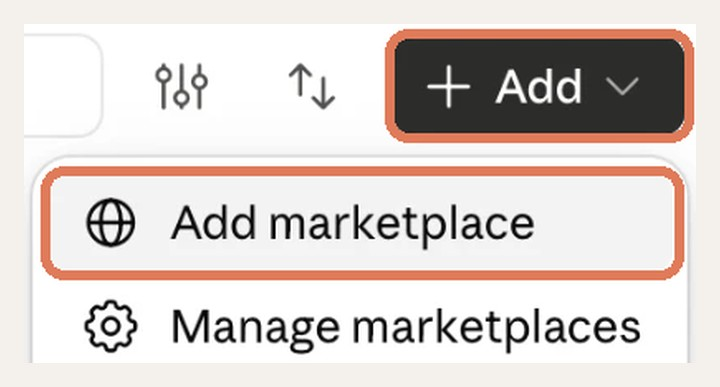</p>

**3.** الصق هذا وأضفه:

<div dir="ltr">

```
majedphotos/majed-plugins
```

</div>

**4.** يطلع لك **Majed video** — أضفه.

<p align="center">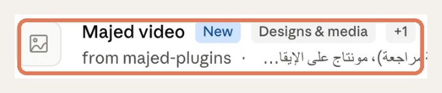</p>

**5.** بعدين **Add** ← **Manage marketplaces** ← **⋮** ← شغّل **Sync automatically** (حتى كل تحديث يوصلك بروحه).

<p align="center">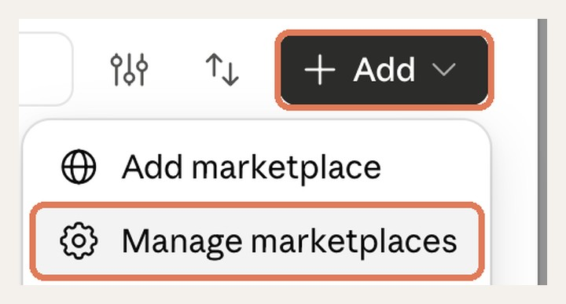</p>

<p align="center">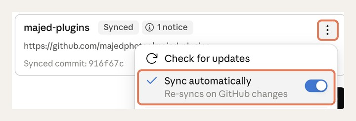</p>

> ✅ **تأكد إنه انضاف:** بـ**Plugins** تشوف **Majed video** بالقائمة. ما طلع؟ أعد الخطوة 3.

### 2️⃣ افتح محادثة جديدة

من قائمة الموديل جنب زر الإرسال ← **Opus 5.5** ← **Effort** ← **Max** (أقوى نتيجة).

### 3️⃣ أرفق الفيديو واكتب جملة

مثلاً: **«منتج هذا المقطع»** أو **«حوّل الفيديو لريل»**. أول مرة تطلع لك [صفحة التعارف](#taste) (ألوانك وخطك وحركاتك)، وبعدها يطلّع لك الريل. تبي تعديل؟ اكتبه بنفس المحادثة.

<a id="phone"></a>

### 📱 من الجوال — بدون لابتوب

<p align="center">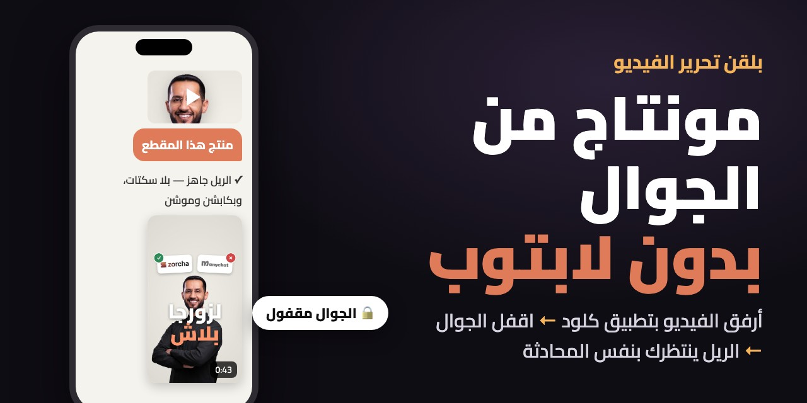</p>

نفس الخطوات الثلاث من **تطبيق كلود بالجوال**: أرفق الفيديو، اكتب طلبك، و**اقفل الجوال** — المونتاج يشتغل بسحابة كلود والريل ينتظرك بنفس المحادثة.

> ⏱️ السحابة أبطأ من الكمبيوتر (قص الشخص عن الخلفية ≈ 18 دقيقة لفيديو 40 ثانية)، فخلّه يشتغل وارجع له. حد حجم الفيديو المرفق حسب التطبيق.

> 🧑‍💻 **تستخدم الطرفية (تيرمنال) أو تبي تحمّل الملف بيدك؟** [طرق التثبيت الثانية تحت](#install).

<br>

---

## 📺 الشرح بالفيديو — على يوتيوب

<p align="center"><a href="https://www.youtube.com/playlist?list=PLP3JSi62X3BE">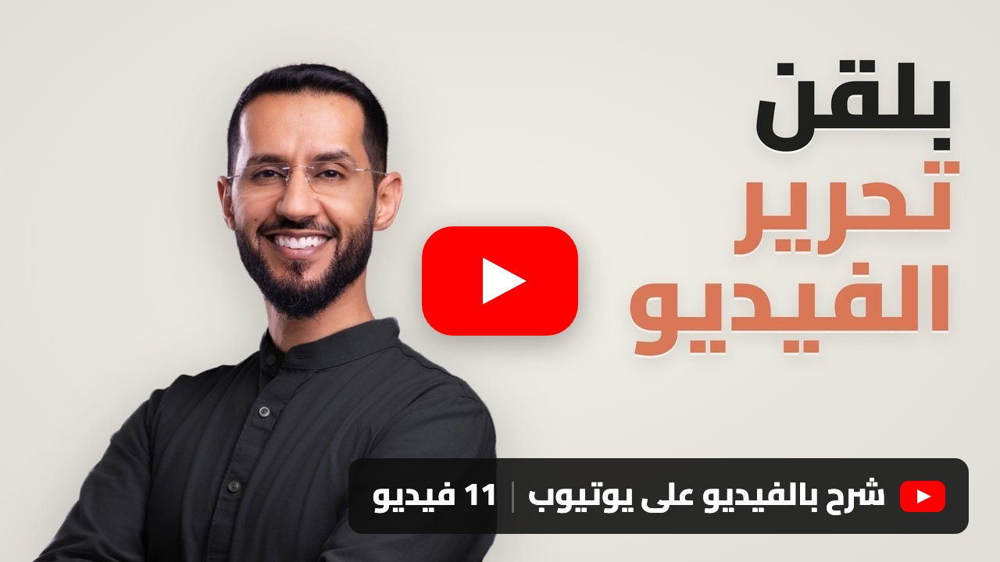</a></p>
<p align="center">▶️ <b><a href="https://www.youtube.com/playlist?list=PLP3JSi62X3BE">افتح الشرح على يوتيوب</a></b> — 11 فيديو قصير (حوالي نص ساعة): التثبيت، صفحة التعارف، وشلون تطلع أول فيديو، خطوة بخطوة.<br>
<sub>هذي الصورة <b>فيديو شرح</b>، مو تحميل — التثبيت من الخطوات فوق ↑</sub></p>


<br>

---

## 🗣️ شنو تقدر تسوي — كل شي بجملة

ما تحتاج أوامر ولا إعدادات. اكتب لكلود **الجملة اللي تحت كل وحدة**، وهو يكمّل.

<table width="100%"><tr>
<td width="20%" align="center" valign="top">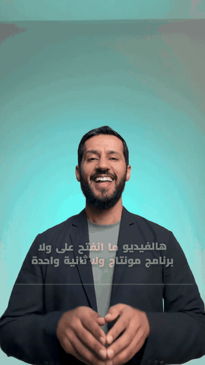<br><b>🎙️ ريل من فيديو تتكلم فيه</b><br><sub>يشيل السكتات · كابشن يمشي مع فمك · موشن من معنى كلامك</sub><br><b>«منتج هذا المقطع»</b></td>
<td width="20%" align="center" valign="top"><br><b>⚙️ شرح أي جهاز كآلة</b> 🆕<br><sub>يرتسم بالحبر ويشتغل · الحقائق من مصدر</sub><br><b>«اشرح لي شلون يشتغل المكيف»</b></td>
<td width="20%" align="center" valign="top">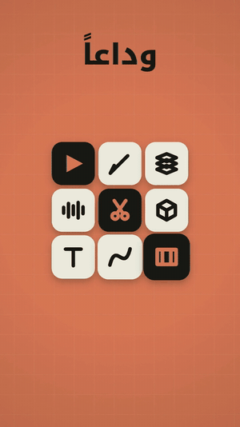<br><b>✨ فيلم موشن من نص</b><br><sub>3D بـ60 فريم · بلا تصوير ولا شخص</sub><br><b>«سو فيديو موشن من هالنص»</b></td>
<td width="20%" align="center" valign="top">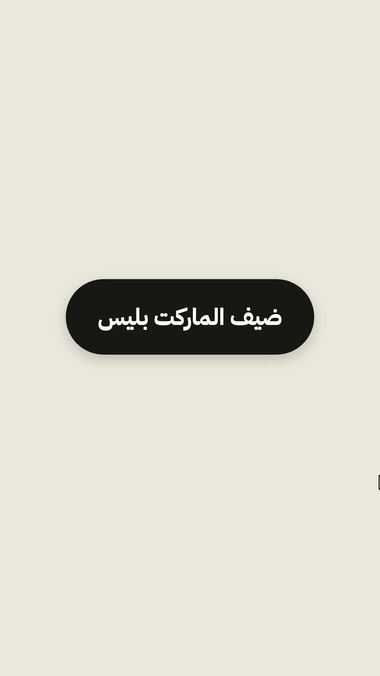<br><b>🎥 ونشوت — لقطة وحدة بلا قص</b><br><sub>زوم إن لين الزر يبلع الشاشة… وزوم آوت يكشف</sub><br><b>«سو فيديو ونشوت عن …»</b></td>
<td width="20%" align="center" valign="top"><br><b>🎞️ مونتاج مقاطع بلا كلام</b><br><sub>مجلد مقاطع ← ريل على الإيقاع</sub><br><b>«مونتاج من هالمقاطع»</b></td>
</tr></table>

<table width="100%"><tr>
<td width="20%" align="center" valign="top">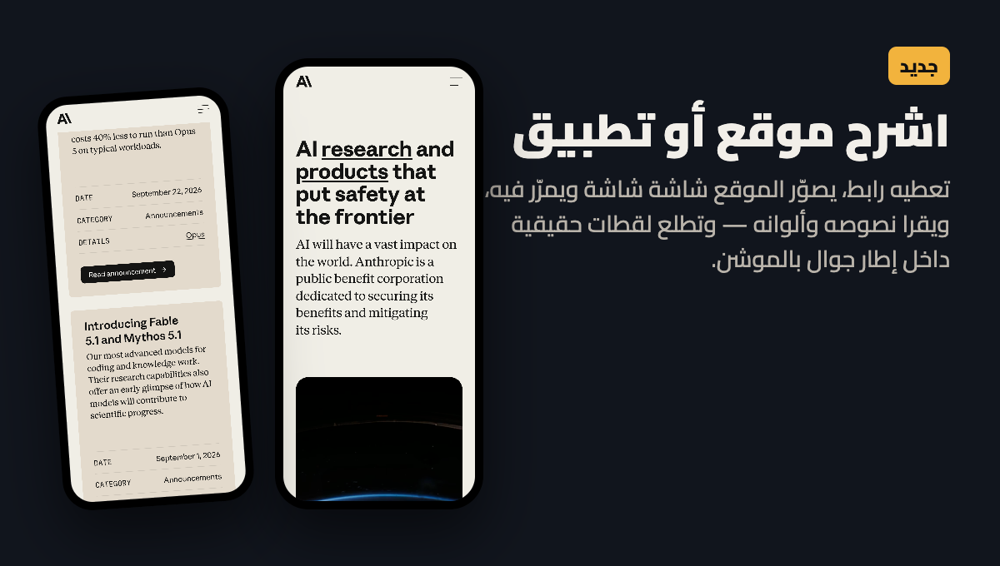<br><b>📱 شرح موقع أو تطبيق</b><br><sub>لقطات حقيقية داخل آيفون أو ماك بوك 3D</sub><br><b>«اشرح هالموقع بفيديو: الرابط»</b></td>
<td width="20%" align="center" valign="top">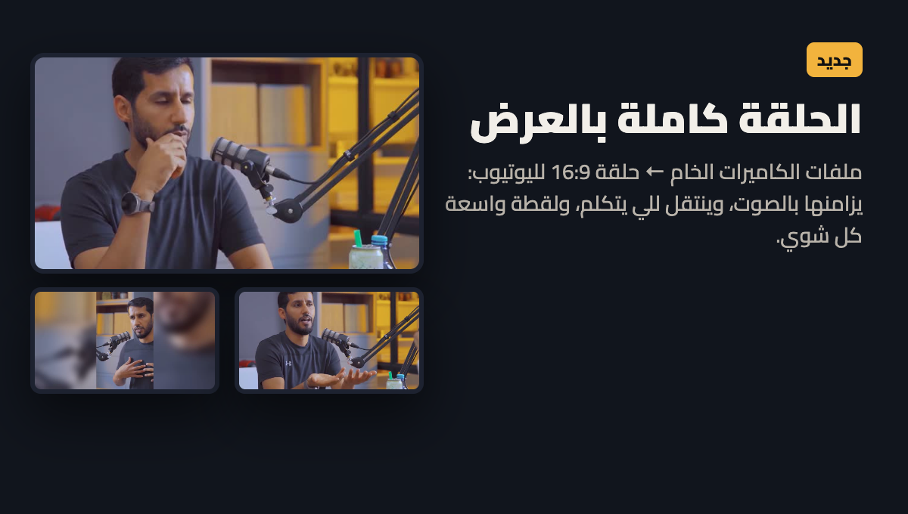<br><b>🎧 بودكاست ومقابلات</b><br><sub>كاميرتين ← ريلات بهوك مكتوب · الحلقة كاملة 16:9</sub><br><b>«سو ريلات من الحلقة»</b></td>
<td width="20%" align="center" valign="top">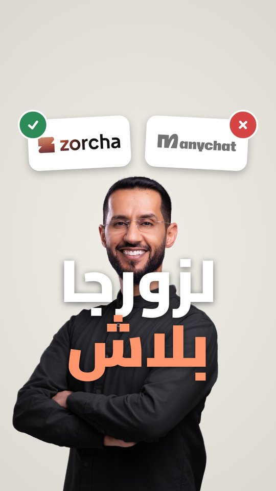<br><b>🖼️ كفر وثمبنيل ينقرون بالجوال</b><br><sub>كفر الريل أول فريم · ثمبنيل يوتيوب بثلاث أفكار</sub><br><b>«سو كفر» · «ثمبنيل يوتيوب»</b></td>
<td width="20%" align="center" valign="top">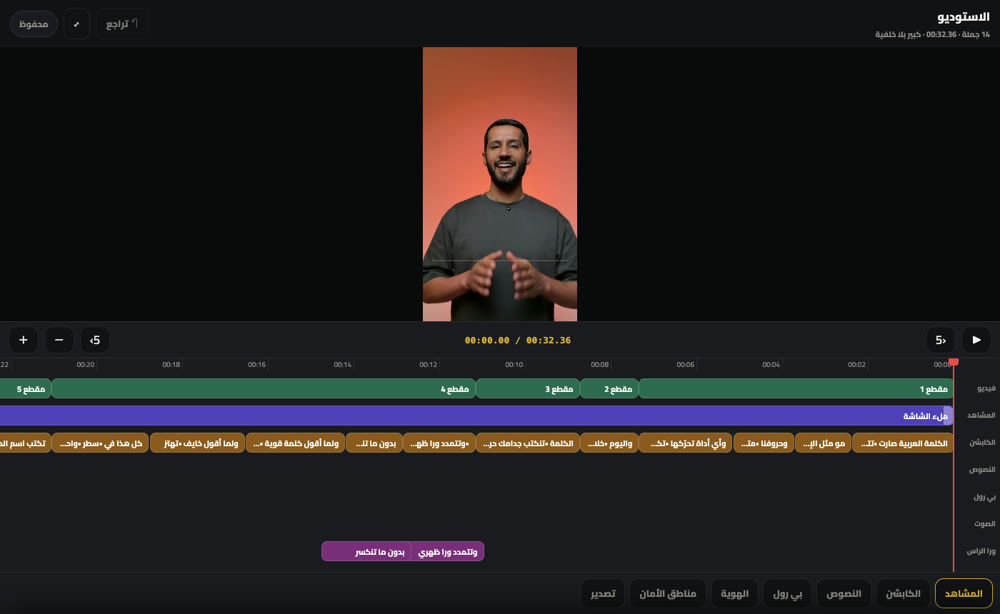<br><b>🎚️ تعدّل بإيدك</b><br><sub>تايملاين من الكمبيوتر أو الجوال · وكل تعديل ما يصرف توكنز</sub><br><b>«افتح الاستوديو»</b></td>
<td width="20%" align="center" valign="top">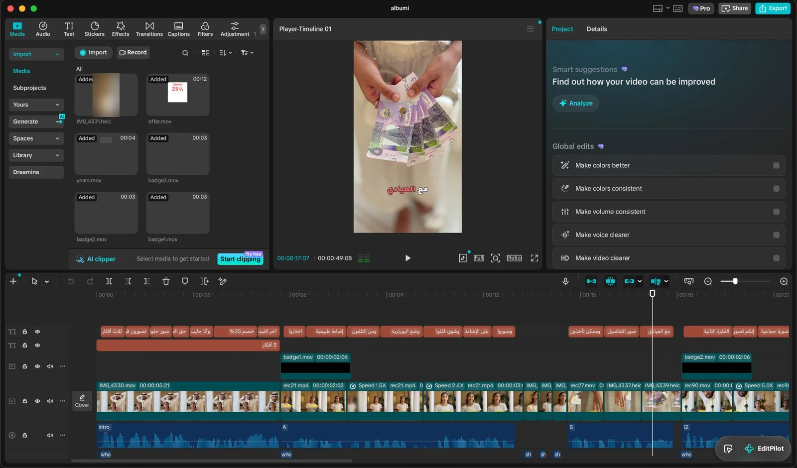<br><b>✂️ مشروع كاب كت</b><br><sub>كل شي قطعة تعدّلها: كابشن، فويس، مؤثرات، موشن</sub><br><b>«سوّه بكاب كت»</b></td>
</tr></table>

<details><summary><b>كاب كت — شلون يمشي</b></summary>

**شلون يمشي (3 خطوات):**
1. افتح كاب كت، سوّ **مشروع جديد فاضي** وسمّه، وبعدين **سكّر كاب كت كامل** (Cmd+Q) — لو مفتوح يكتب فوق الشغل.
2. قل لكلود **«سوّه بكاب كت»** وعطه الفيديو. يعرض عليك لقطات الموشن قبل ما يكمّل.
3. يقول لك «خلصت» ← افتح كاب كت وادخل المشروع، كل شي فيه تقدر تعدّله.

> يشتغل من **كلود على الكمبيوتر** (تطبيق الديسكتوب أو Claude Code) لأنه يكتب ملفات المشروع بجهازك — مو من الجوال. وتحتاج **كاب كت ديسكتوب** (ماك أو ويندوز)، مو تطبيق الجوال.

> يشتغل من **كلود على الكمبيوتر** (تطبيق الديسكتوب أو Claude Code) لأنه يكتب ملفات المشروع بجهازك — مو من الجوال. وتحتاج **كاب كت ديسكتوب** (ماك أو ويندوز)، مو تطبيق الجوال.

<sub>كاب كت علامة تجارية لشركة بايت دانس — البلقن ما له علاقة رسمية فيها.</sub>
</details>

### وجمل ثانية تنفعك

| تبي | اكتب |
|---|---|
| تشيل جمل من الفيديو | «شيل 5 و8» (بعد ما يطبع لك كلامك مرقّم) · «رجّعها» |
| ثيم من صور تعجبك | أرسل الصور + «أبي ستايل جذي» |
| تشوف الحركات وتختار | «ورني بنك الحركات» |
| تغيّر ألوانك وخطك | «غيّر إعداداتي» |
| تستخدم منصة توليد عندك (fal · Higgsfield · ElevenLabs) | «استخدم fal للبي-رول» |
| نفس الريل بدافنشي ([إضافة منفصلة](https://github.com/majedphotos/majed-davinci)) | «سوّه بدافنشي» |

<a id="taste"></a>

## 🧭 يتعرّف على ذوقك — أول مرة بس
<p align="center">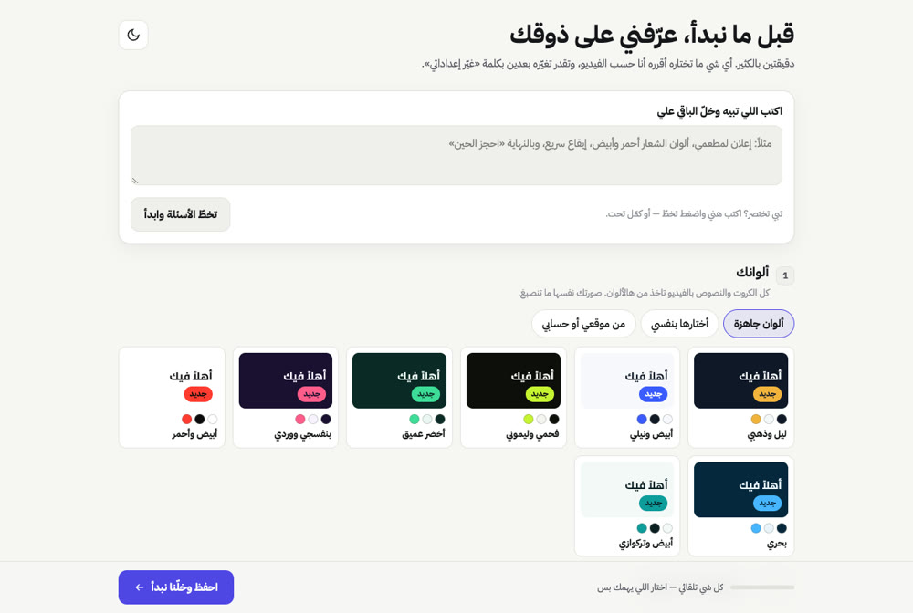</p>

صفحة صغيرة تختار فيها ألوانك، الخط، ستايل الكابشن، الإيقاع، والصوت — أو تكتب اللي تبيه وتخطّاها. كل فيديو بعدها يمشي على ذوقك.

## 🎨 ما يكرر نفسه — 100 حركة و17 ستايل

<p align="center">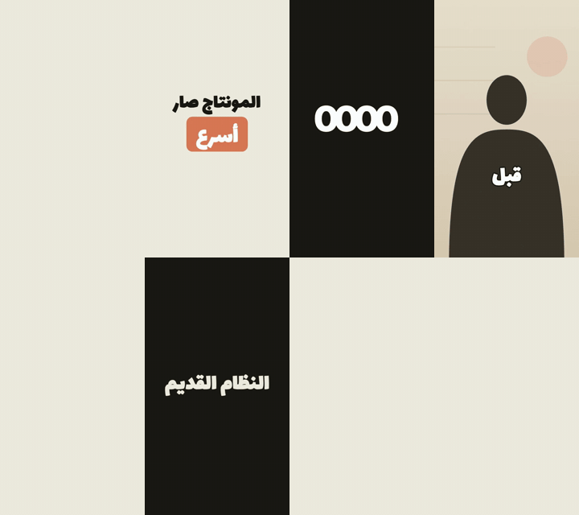 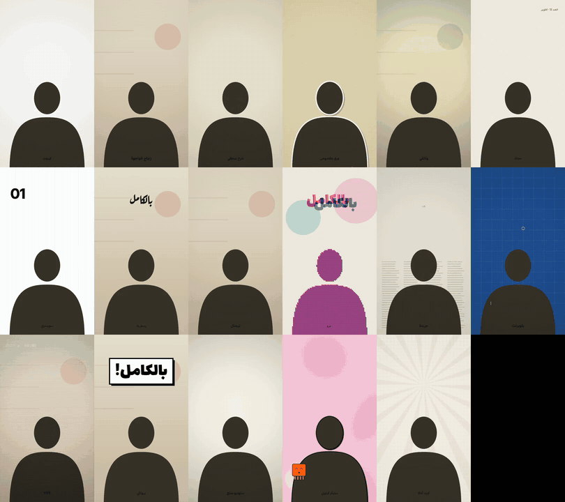</p>

قبل كل فيديو يختار له **لوحة**: 3 حركات أساسية يدور حولها الفيديو، وستايل للفيديو كله (ورق مقصوص، وثائقي، كينوت، شرح صحفي…). ويحفظ سجل، فالفيديو الجاي يطلع غير. البنك أساس مو حد — أقوى اللحظات يخترعها من جملتك.

<details><summary><b>الـ100 كلها</b> — كل مربع رقم الحركة بالبنك، والجديدة (62–100) بإطار ورقمها أسود</summary>
<p align="center">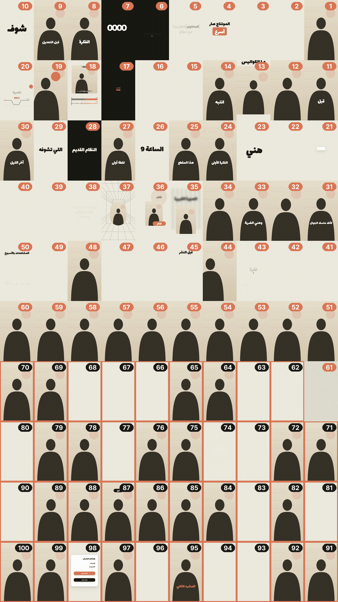</p>
</details>

<br>

---

## 🎓 البلقن مجاني — الدورة تعلّمك شلون تسوي مثله وأكثر
كل اللي فوق انبنى بكلود. بالدورة تتعلم شلون تبني أدواتك انت: سكلات، أتمتة، ومحتوى يشتغل لك — من الصفر وبالعربي.

<p align="center">
  <a href="https://www.dawrat.com/course/ahtrf-klwd-90f4">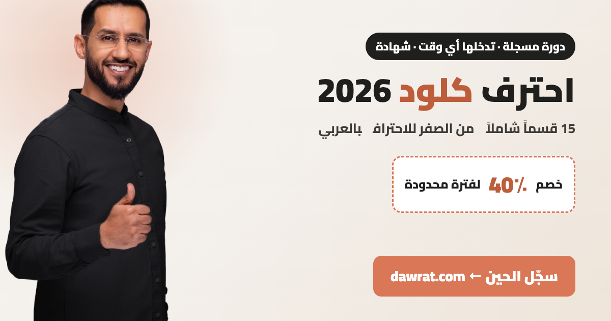</a>
  <a href="https://www.instagram.com/channel/Abb1FvYoeUSGuaVM/">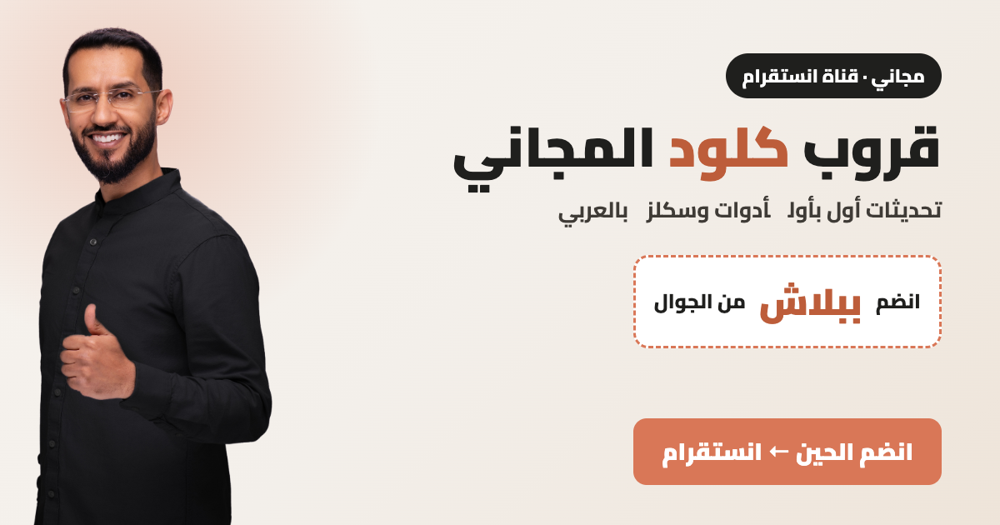</a>
</p>


---

## 📚 تفاصيل (اضغط تفتح)

<details><summary><b>🧰 طرق تثبيت ثانية — للمتقدمين</b> (الطرفية · ملف البلقن · دافنشي)</summary>

<a id="install"></a>

> معظم الناس يكفيهم [ابدأ هنا](#start). هذي لو تستخدم الطرفية أو تبي ملف البلقن بيدك.

**البلقن = 5 سكلات بحزمة وحدة** (ريل · موشن · بودكاست · مونتاج · كفر وثمبنيل). ودافنشي [إضافة منفصلة](https://github.com/majedphotos/majed-davinci) لمن عنده دافنشي ريزولف ستوديو.

> ☝️ **اختر طريقة وحدة بس** — لو ثبّتّه بأكثر من طريقة يصير عندك نسخ مكررة من نفس السكلات. عندك أكثر من وحدة؟ شيل النسخ الزايدة من **Customize ← Plugins**.

> 🏷️ **اسمين لا تتلخبط فيهم:** المتجر الموحد `majedphotos/majed-plugins` (نفسه بـclaude.ai والتيرمنال) · اسم البلقن `majed-video`. أمر الإضافة ياخذ اسم **المستودع** (`majedphotos/majed-plugins`)، وأمر التنصيب ياخذ **البلقن@المتجر** (`majed-video@majed-plugins`).

### حمّل الملف وارفعه

1. [**حمّل البلقن**](https://github.com/majedphotos/video-ad-editor/releases/latest/download/majed-video.plugin) (ملف `majed-video.plugin`)
2. افتح تطبيق **كلود** ← **Customize** ← **Plugins** ← **Upload plugin** ← اختر الملف

> ⚠️ هالطريقة **ما تتحدّث بروحها** — كل نسخة جديدة حمّلها وارفعها من جديد.

### من الطرفية (تيرمنال)

**تحتاج Claude Code منصّب.** افتح الطرفية (تيرمنال) — **Terminal** بالماك أو **PowerShell** بالويندوز (مو تبويب Code بتطبيق الديسكتوب) — واكتب `claude --version`. طلع لك رقم نسخة؟ كمّل. طلع `command not found: claude`؟ Claude Code مو عندك — **استخدم [ابدأ هنا](#start)**، ما تحتاج شي ثاني.

الصق الأوامر **واحد واحد** (الأمر ← Enter ← انتظر):

<div dir="ltr">

```
claude plugin marketplace add majedphotos/majed-plugins
```

```
claude plugin marketplace list
```

```
claude plugin install majed-video@majed-plugins
```

</div>

- **تحقق بعد الأمر الأول:** الأمر الثاني (`marketplace list`) **لازم يظهر فيه `majed-plugins`**. ما ظهر؟ شغّل الأمر الأول مرة ثانية (لو الاتصال تقطّع)، وبعدها ارجع للقائمة.
- **طلع لك `Failed to add marketplace … extraKnownMarketplaces`؟** لا تكمّل على أساس إنه «مضاف من قبل». شغّل `claude plugin marketplace list` — لو `majed-plugins` ما يظهر، المتجر ناقص فعلاً: أعد الأمر الأول.
- **أعد تشغيل `claude`** بعد التثبيت، وإلا ما تظهر السكلات بالجلسة.
- **ركّبته قبل من المتجر القديم (`majedphotos/video-ad-editor`)؟** شيله حتى ما يتكرر البلقن: `claude plugin marketplace remove majed-video` — المتجر الموحد `majed-plugins` فيه نفس البلقن + مصنع المحتوى، ونفس المتجر اللي بـclaude.ai.

بعدها **شغّل التحديث التلقائي**: بالطرفية (تيرمنال) العادية اكتب `claude` ← Enter، وبعدين:

<div dir="ltr">

```
/plugin  →  Marketplaces  →  majed-plugins  →  Enable auto-update
```

</div>

> ℹ️ أمر `/plugin` تفاعلي ويشتغل **بالطرفية (تيرمنال) العادية بس** — ما يشتغل داخل تطبيق الديسكتوب (تبويب Code). وخطوة «Enable auto-update» تظهر فقط لو `marketplace list` فيه `majed-plugins`.

<p align="center">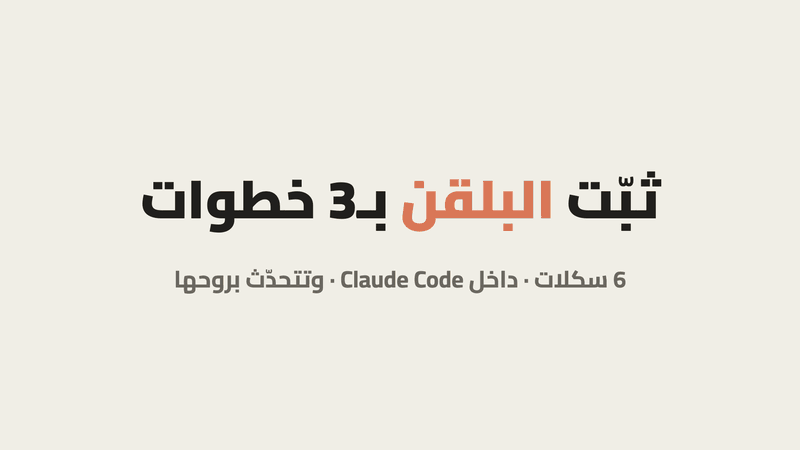</p>

> 🔁 **تبي آخر نسخة الحين؟** بالطرفية (تيرمنال): `claude plugin update majed-video@majed-plugins`
>
> 🧹 **منصّب النسخة القديمة كسكل (ملف `.skill`)؟** شيلها حتى ما تتكرر — البلقن فيه كل شي.
>
> 📦 **تبي سكل الريل بروحه؟** [نزّل `video-ad-editor.skill`](https://github.com/majedphotos/video-ad-editor/releases/latest/download/video-ad-editor.skill) ← دبل كليك ← وافق. (سكل وحدة بكل الأوضاع، بس ما فيها باقي سكلات البلقن)
>
>
> 🤖 **كودكس وأي وكيل يشغّل أوامر:** يقرأ `SKILL.md` ومجلد `references/` كتعليمات ويشغّل نفس السكربتات ([`any-environment.md`](video-ad-editor/references/any-environment.md)) — *غير مجرَّب بعد على كودكس نفسه.*

<p align="center">🎬 <b>فيديو كامل منتجه البلقن:</b></p>

https://github.com/user-attachments/assets/1047c4e8-141c-4f45-b601-c58d1353fe4c

### 🎬 دافنشي — إضافة منفصلة
عندك **دافنشي ريزولف ستوديو**؟ نصّب الإضافة [`majed-davinci`](https://github.com/majedphotos/majed-davinci) — نفس العقل، والمخرج تايملاين تعدّل عليه بإيدك:
```
/plugin install majed-davinci@majed-plugins
```


</details>

<details><summary><b>🔧 المتطلبات والخصوصية</b></summary>

**المتطلبات:** البلقن ينزّلها بنفسه بعد إذنك: **ffmpeg** (القص والصوت) · **Whisper** (التفريغ بتوقيت الكلمة) · **Chrome** (الرسم). ماك وويندوز. وضع دافنشي يحتاج **دافنشي ريزولف ستوديو 21.1** أو أحدث — من موقع بلاك ماجك، مو من آب ستور (ما فيها البرمجة).

**الخصوصية:** على الكمبيوتر كل شي على جهازك — **فيديوك ما يرتفع لأي سيرفر.** من الجوال، الفيديو يروح لسحابة كلود بحسابك (هي اللي تمنتجه). الاستثناءات اختيارية وتشغّلها أنت (المشاهد المولّدة بالذكاء الاصطناعي).


</details>

<details><summary><b>💬 كلمة بآخر الريل ← رابط بالخاص</b> (اختياري)</summary>

ريلات الحلقة تنتهي بـ«اكتب [كلمة] توصلك الحلقة كاملة». عشان الرد يصير تلقائي: [زورجا](https://zorcha.com) — الأوتوميشن مجاني، والتحكم فيه من كلود (MCP) باشتراك. كود **MAJED** (كود شراكة) يعطيك **15% على الخطة الربع سنوية و30% على السنوية**. التفاصيل: [`keyword-automation.md`](video-ad-editor/references/keyword-automation.md).

</details>

<details><summary><b>📜 سجل الإصدارات</b></summary>

### جديد في 6.5 — «مستوى ثاني» للريل (من دليل captions reel)
- **توقيت الكلمة على موجة الصوت:** بداية كل كلمة على أول ارتفاع بالصوت بدل تقدير وِسبر (كان يسبقها ~0.1 ث).
- **العمق:** الغرفة ← كلام ورا راسك ← أنت ← كلام قدامك، وكاميرا تتحرك بين الطبقات. وبلا كابشن لو تبي — الكلام كلمات بالمكان.
- **الكلمة المضيئة تنوّر المكان:** كلمة متوهجة تغيّر الإضاءة على وجهك وحولك بلونها، والغرفة تغمق بلون قريب منها أو من البراند.
- **قصّ الشعر بيريف نت:** حواف شعر ناعمة بلا هالة من لون الغرفة (مجاني، على جهازك) — قصّ الماك احتياط.

<p align="center"></p>

- **مربع بالضبط على المعلومة:** يقرأ الكتابة على المنتج (ملصق، شاشة) ويلحقها فريم بفريم.
- **46 مؤثر حقيقي (CC0)** بتسع أنواع + قلم يرسم وسوط، وكل صوت مربوط بحركة صارت على الشاشة وتحت صوتك.
- **ستوري بورد** قبل الرسم (`32_midframes.py --story`) · **ملاحظة على الفريم** بصفحة المراجعة · **ملف ذوق** يكبر مع كل ملاحظة تنجح.
- **حركة 101 «قائمة تنكشف»:** كرت بإطار يدوي وبنود مبكسلة، كل بند ينكشف لما تنطق كلمته وشريط هايلايت بلون هويتك ينتقل معه.

### جديد في 6.3 — «اشرح لي شلون يشتغل …»
- **وضع جديد بسكل الموشن:** أي جهاز يصير آلة مقصوصة ترتسم بالحبر خط خط، ثم تشتغل (دوران، توهّج، موجات، بخار) وتحتها 2–3 خطوات.
- **الحقائق قبل الرسم:** كل جملة على الشاشة لها مصدر واقتباس بـ`facts.md` — اللي ما له مصدر يطلع بالرسمة بلا كابشن.
- **جملة المستخدم تنكتب بفقاعة** فوق الآلة (`ask`) — المشاهد يشوف شنو انطلب بالضبط.
- مثال شغّال: `motion/examples/machine/` (استشوار + مايكرويف) · الدليل: [`machine-explainer.md`](video-ad-editor/references/machine-explainer.md).
- أدوات الرسم الإيزومتري من مشروع [Anatomy](https://github.com/wheresryan22/anatomy) (رخصة MIT).

### 🆕 جديد في 6.2.1 — دروس ريل «1000$ بيوم»
- **ستايل كابشن `chunk`:** قطع لين 4 كلمات بكبسولة، والكلمة المنطوقة بلون التمييز بلا قفز (وفواصل يدوية بـ`CHUNK_BREAK`).
- **الأرقام ما تنقلب بالعربي:** «25–30» كانت تطلع «30–25» — المحرّك يعزلها لحالها بالكابشن والمشاهد.
- **رجوع نظيف** من «راسك برّا المستطيل» (`tr` لكل مشهد) تحت تكبير يغطي الشاشة، و`headbox` ينكتب دايماً (كان يفشل بصمت).
- **فحص هلوسة وِسبر** وإصلاحها بقطع بلا سياق (`02a_whisper_check.py`).
- **الريل الطويل تحت 30 ميقا:** ترميز بمرحلتين بمعدل محسوب.
- **العنصر ما يختفي مع آخر كلمة:** يقعد شوي ويطلع بهدوء، والكابشن يقعد بعده.
- وصفتين جديدة بالبنك: إضاءة بلون العميل ورا الشخص + انتقال سبارك. و`MK.*` يشتغل بلا سطر ترقيع.

### جديد في 6.2 — موشن «لقطة وحدة» و3D حقيقي
<p align="center"></p>

- **إطار ثابت** (`MOTION.stage`): العنوان فوق ما يتحرك، وتحته سطر يتبدل كلمة كلمة ويكمّل الشرح (`ctx.text.slot`)، والمشاهد تتبدل داخل نافذة — الفيلم يبين لقطة وحدة.
- **جدار شرائح 3D** (`ctx.slideWall`): الكاميرا تطير فوق كروت بسماكة، وكرت ينزل ويصير أول مشهد بلا قص.
- **موشن بلير حقيقي** (`motionBlur`) على الحركات السريعة والانتقالات.
- **شعار 3D حقيقي بريل الكلام** (`41_logo3d.js` + `MV.overlay`): بسماكة ولمعة وظل.
- الإطار والجدار والشعار 3D **بطلبك بس** — مو بكل فيديو. والألوان من ثيمك (فاتح أو غامق).
- مثال شغّال: `motion/examples/stage-wall/`.

### جديد في 6.1 — بنك الستايلات
- **17 ستايل** للفيديو كله (`references/styles.md`): كينوت · زجاج الواجهة · شرح صحفي · ورق مقصوص · وثائقي · مجلة · سويسري · رسم يد · تيرمنال · ريزو · جريدة · بلوبرنت · VHS · بروتالي · ستوديو منتج · ستيكر كرتوني · كرت أداة.
- **لوحة الفيديو تختار الستايل** مع الحركات (`35_moves.py plan` ← `style`)، وثلث الفيديوهات تطلع **دمج** ستايلين. `--style paperCut` أو `--style none` لو تبي.
- **بالماك الستايل يبدّل الخلفية** وانت مقصوص فوقها (ستيكر بحد أبيض، هافتون، سيبيا على الخلفية بس). برّا الماك يلبس ألوانه وخطوطه وكروته فوق الفيديو العادي.
- يمشي بفيلم الموشن (`"style"` بـ`project.json` ← `ctx.S`) وبريل الكلام (`MV.useStyle`).
- لون هويتك يبقى، إلا الستايلات اللي لونها جزء منها (مثل أصفر قلم التحديد وأحمر الختم).

### جديد في 6.0 — دروس ريل بوبيان
ريل اعتمده البنك وانتشر — كل اللي تعلّمناه منه صار بالبلقن:
- **موشن عميق من أول مسودة:** قبل الرسم يخطّط 2–3 «لحظات عمق» — عنصر يمر ورا راسك، موجة تتحرك مع صوتك الحقيقي، خريطة نقاط وراك، مدار ثلاثي الأبعاد يلف حولك، شكل من هوية العميل يصير حركة، ودخلة ون تيك بالشعار. البطاقات والأختام مو ممنوعة — بس مو هي الأصل.
- **موجة صوتك:** `37_env.py` يطلّع علو صوتك لكل فريم، والرسم يتحرك معه (`MV.env`).
- **«طبقات» أذكى:** تختار كم كلمة فوق الراس وكم وراه (`"stack":{"above":2,"behind":1}`)، وبعد «طبقات» لجزء من الجملة الكابشن يكمّل الباقي بس — ما تنقرا الجملة مرتين.
- **الكفر يختار وجهك:** مو لقطة بي-رول فيها شخص ثاني، والكلام ما يغطي وجهك باللقطة القريبة.
- **طبقة فوق الشخص** (`window.AFTER_PERSON`) للنص اللي لازم يبين قدّامك بوضع القصّ.
- **الزوم مقفول لكل مقطع** — تشيل أو تضيف مقطع وإحداثيات رسمك تبقى صح.
- إصلاحات: الرسم يوقف بخطأ واضح بدل «0 فريم» لو `sfx.json` بلا `outro` · فحص المنطقة الآمنة ما يعطي إنذار كاذب على الانتقالات · تنصيب الإضافات يشتغل مع pip القديم.

### جديد في 5.0
- **بنك الحركات صار 100:** 39 حركة جديدة من بحث بترندات 2025–2026 — منها حركات عربية ما أحد يسويها: **نقاط تنزل** (الكلمة بلا نقاط ثم تنزل النقاط)، **حروف تتلاصق**، **القلم يكتب**، **كوفي مربع**، **كلمة تذوب بكلمة**، **زخرفة تتفتح**، و**آية بسكينة** بخط أميري قرآن (النص من مصدر موثوق بس، والرقم داخل ۝ مثل المصحف).
- وحركات للكلام: ستيكر، أشعة من وراك، نسخ مني، خط حولك، الكاميرا تلحقك، بكفّك، فقاعة كلام، كاميرا ثانية، وغيرها.
- **إصلاح الخط:** التاء المربوطة بخط الرقعة كانت تطلع بلا نقطتين («الخطوه»)، والكلمات اللي تطلع من تحت كانت تنقص ذيولها («تمنتج»). انصلحوا بالمحرّك نفسه.

### جديد في 4.7
- **بنك الحركات صار 61:** 11 حركة جديدة — مدار، جدار الكنبة، عالم الواجهات، كسر الإطار، جدار العناوين، رسومات ترجف، غلاف مجلة، كلام زجاجي، الفيديو داخل الجوال، قرين سكرين بالنص، قصاصة ورق.
- 7 منها تقصّك من الخلفية (ماك)؛ على غيره تطلع بشكل بديل (كرت أو فقاعة) بدون ما تنكسر.

### جديد في 4.6
- **دافنشي صار إضافة لحالها** ([`majed-davinci`](https://github.com/majedphotos/majed-davinci)) — البلقن الأساسي أخف، واللي ما عنده دافنشي ما يشيل ملفاته.
- **ملف البلقن أخف:** مكتبة الثري دي صارت ملف واحد ينفك أول مرة — مكان لإضافات جاية.

### جديد في 4.5
- **بنك الحركات:** 50 حركة مرقّمة بمصادرها، وكل فيديو يطلع بلوحة حركات خاصة فيه وما تتكرر ورا بعض.
- الحركات تشتغل بالريل من فيديو كلام وبفيلم الموشن والونشوت.
- **صفحة التعارف:** قسم جديد «الحركات». تخليها عليه، أو تفتح البنك وتختار اللي تحبه واللي ما تبيه.

### جديد في 4.3
- **صار بلقن واضح:** 6 سكلات بحزمة وحدة — والسادسة **دافنشي** بروحها («سوّه بدافنشي»).
- **فيديو تعليمي للتثبيت** فوق الصفحة + التحديث التلقائي.

### جديد في 4.2
- **الكفر والثمبنيل:** صورتك من الفيديو نفسه (قصّ آلي) أو من صورك · خلفية كريمية · الوجه أكبر بفكرة «قبل/بعد».
- **دافنشي:** شنو النسخة اللي تشتغل (ستوديو من موقع بلاك ماجك — مو آب ستور).

### جديد في 4.1
- **سكل الكفر والثمبنيل** (`thumbnail-video`) — أحجام تنقرا بالجوال (مقاسة + بحث)، كفر أول فريم، وثمبنيل يوتيوب بثلاث أفكار.

### جديد في 4.0
- **أربع سكلات بمحرّك واحد** بدل سكل واحد ثقيل — كل وضع يقرا تعليماته بس.
- **صفحة التعارف** صارت للكل.
- **وضع دافنشي** صار للكل — وقابل للتعديل: كل شي قطعة على مساره.
- **تعليمات مرتبة** — الملف الرئيسي أخف بـ38٪.
- **اختبار آلي** يمر على كل الخطوات قبل أي إصدار.


</details>

<details><summary><b>🛠️ للمطوّرين</b></summary>

خريطة كل السكربتات والملفات: [`references/script-map.md`](video-ad-editor/references/script-map.md) · التعليمات: [`SKILL.md`](video-ad-editor/SKILL.md) · السكلات الثانية: [`motion-video`](motion-video/SKILL.md) · [`podcast-video`](podcast-video/SKILL.md) · [`montage-video`](montage-video/SKILL.md) · [`thumbnail-video`](thumbnail-video/SKILL.md) · [`davinci-video`](davinci-video/SKILL.md)

<b>الإصدارات السابقة</b>

- **6.6.0** `35_moves.py inspire <كلمات إنقليزية>`: أفكار حركة من فهرس عام (`awesome-opus5-5-videos`، رخصة MIT) ينسحب وقت الحاجة لكاش عند المستخدم (`~/.video-ad-editor/cache`، 7 أيام) — إلهام بس، لا برومبت ولا بيانات داخل البلقن، وبلا نت المونتاج يكمل عادي
- **6.5.2** ألوان مطابقة للتصوير: الفريمات والتجميع بفلتر `colorspace` (الصيغتين `VF_FRAMES`/`VF_ENCODE` بـ`scripts/_compat.sh`)، `03_cut_zoom.py` يطلّع `vfr` بنفسه، وملف ألوان الحاوية يبقى بعد الكفر والماستر
- **6.5.1** حركة 102 «تفكيك الطبقات» (`FX.explode`) + `MV.text.headGap` (الكشيدة على الراس — لا حرف ولا نقطة تنخفي) + الغلاف (57) `head` و`place`
- **6.4.0** سكل `review-video`: ريل مراجعة منتج بتعليق صوتي، خطوط تتبع القطعة، كرت خصم، وكفر مقصوص + `references/pro-editor.md` علم المونتاج المشترك + توسيع الطلب وفحص الأدوات أول الشغل
- **6.3.0** وضع «اشرح لي شلون يشتغل …»: الجهاز آلة ترتسم وتشتغل (`references/machine-explainer.md` + `motion/examples/machine/`)
- **6.2.1** دروس ريل «1000$ بيوم» (كابشن chunk · الأرقام ما تنقلب · رجوع نظيف · فحص وِسبر · حجم الريل)
- **6.2.0** إطار ثابت + جدار شرائح 3D + موشن بلير + شعار 3D بريل الكلام

- **6.1.0** بنك الستايلات: 17 ستايل للفيديو كله، ولوحة الفيديو تختار أو تدمج ستايلين
- **6.0.1** أول الجلسة ينصحك بالموديل والجهد للنتيجة الأقوى (Opus 5.5 + max) وشلون تختاره بالشات أو Claude Code
- **6.0.0** دروس ريل بوبيان: لحظات العمق أصل من أول مسودة (ورا الشخص · موجة الصوت `37_env.py`/`MV.env` · خريطة · مدار · هوية العميل · ون تيك) · «طبقات» `above/behind` + الكابشن يكمّل بعد الطبقات الجزئية · الكفر يختار وجه المتكلم وما يغطيه · `AFTER_PERSON` · زوم مقفول لكل مقطع · `outro` الافتراضي 0 + خطأ واضح بالمدة · فحص الأمان يتجاهل `MV.frameAt` · pip القديم بـ`--extras`
- **5.1.0** إعلان هادي بمفاتيح بالثيم: `capStill` (كابشن بلا حركة — التلوين يبقى) · `bar: false` (بلا شريط تقدّم) · `zoomB: false` لحركة الباب (بلا زوم على الوجه) + انتقال الفيديو بين الشاشة الكاملة والكرت صار ناعم (الوجه ما يطلع وينزل)
- **5.0.1** الطلعة المتتابعة: الكلمة تطلع نظيفة من السطر بلا حد قناع ينشاف، وتكمل ذيولها بعد ما توصل
- **5.0.0** بنك الحركات 100 (39 جديدة، منها حركات عربية وآية بسكينة بخط أميري قرآن) + إصلاح التاء المربوطة بخط الرقعة وذيول الحروف بالطلعة المتتابعة
- **4.7.0** بنك الحركات 61: 11 حركة جديدة (مدار، جدار الكنبة، عالم الواجهات، كسر الإطار، جدار العناوين، رسومات ترجف، غلاف مجلة، كلام زجاجي، الفيديو داخل الجوال، قرين سكرين بالنص، قصاصة ورق) — 7 منها بقصّ الشخص (ماك) ولها شكل بديل
- **4.5.0** بنك الحركات: 50 حركة مرقّمة بمصادرها + لوحة حركات لكل فيديو (عائلة + 3 أساسيات + لهجات) ما تتكرر + قسم «الحركات» بصفحة التعارف (يختار بنفسه أو يخليها على كلود)
- **4.4.4** صوتك الحقيقي ما ينقص أبداً (القطع تغطي التسجيل كامل والحدود بأهدأ نقطة، ‎-20 LUFS تلقائياً) + سكتة نهاية 0.7 ث بالريل + طريقة التيرمنال صارت على المتجر الموحد `majed-plugins`
- **4.4.3** مثال الونشوت الجديد: زوم إن للأسود ← زوم آوت لجوال ولابتوب، بموشن بلير حقيقي
- **4.4.2** وضع «مونتاج داخل كاب كت»: بدل MP4 يكتب مشروع كاب كت تعدّله بيدك (لقطات بزوم، كابشن ونصوص كاب كت، فويس، مؤثرات، خلفية صوتية، موشن شفاف بألوانك) ← `references/capcut.md`
- **4.4.1** كلمة الختام ← رابط الحلقة بالخاص (أوتوميشن) + كرت الختام من الثيم + طريقة العمل مع كل حلقة بودكاست + خصم زورجا بكود MAJED
- **4.4.0** وضع «الونشوت» (فيديو كله لقطة وحدة بلا قص) + مثال شغّال `motion/examples/one-take/` + مكتبة أمثلة من الناس (`references/examples.md`) + التثبيت من claude.ai بإضافة الماركت بليس
- **4.3.5** إصلاح «Zip cannot contain nested zip files» (كان بـ4.3.3 و4.3.4) · **4.3.4** يشتغل بالجوال والسحابة · **4.3.3** أقل من 200 ملف

- **3.9** الثيم من صور مرجعية · البودكاست كامل 16:9 · شرح موقع/تطبيق + آيفون وماك بوك 3D · كفر الريل · تنظيف صوت ذكي
- **3.8** شرح بالموشن 3D · هوك البودكاست · «طبقات» · مؤثرات الإيقاع
- **3.6-3.7** حزمة الموشن · الموشن من معنى الجملة
- **3.5** حلقة كاملة ← ريلات
- **3.4** الاستوديو (تايملاين باليد)
- **3.3** أخف وأنظف · **3.2** مشاهد مولّدة · **3.1** حركات الكلمة العربية
- **3.0** يحدّث نفسه · **2.9** تسجيل الشاشة بإطار جوال · **2.8** ويندوز (بمساهمة [@thefhiter](https://github.com/thefhiter)) · **2.7** البودكاست
</details>


## الرخصة
MIT — استخدمه وعدّله ووزّعه بحرية.

</div>
